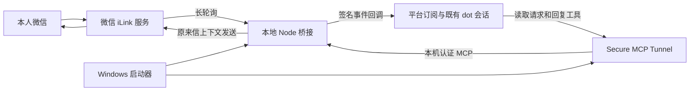

# 架构与消息流程

## 目标

保留既有菲比 / dot 会话的处理能力，通过本人的微信私聊输入文字。当前桥接不调用额外模型 API，不提供群聊、任意收件人发送或联系人查询。

## 组件分工

| 文件 | 职责 |
| --- | --- |
| `windows-pilot/start.ps1` | 明确启动参数、既有代理、NTFS / 当前用户 ACL、Job Object、隐藏密钥输入、可选 DPAPI、扫码窗口、控制命令和退出清理 |
| `windows-pilot/supervisor.mjs` | 子进程最小环境、临时认证、硬截止、启动回执、健康检查、二维码轮询与状态过滤 |
| `windows-pilot/network.mjs` | 检查固定官方目标使用同一个现有 HTTP(S) 代理 |
| `weixin-candidate/ilink.mjs` | 扫码和登录状态机、getupdates、发送回执兼容、认证异常停止 |
| `weixin-candidate/transport.mjs` | 既有代理上的 TLS 传输、固定目标、禁止重定向、限定请求与响应 |
| `weixin-candidate/relay.mjs` | 绑定本人私聊、文字解析、请求存储、正文过期、同上下文回复和幂等状态 |
| `weixin-candidate/service.mjs` | MCP 工具和事件、订阅有效期、回调验证与投递退避 |
| `weixin-candidate/runtime.mjs` | 一次收信轮询与一次回调调度各自保持单路进行，统一硬截止 |
| `src/security.mjs` / `synthetic-pilot/hostname-proxy-callback.mjs` | 签名、回调 URL / 来源检查和既有代理传输 |

`src/store.mjs` 保留通用的内存和加密文件存储类，但当前微信运行时使用 `MemoryStore` 和 `RelayMemoryStore`。类存在不表示微信消息已启用持久化。`synthetic-pilot/service.mjs` 有部分共用协议定义，目录名不是当前流程为模拟的判断依据。

## 一条来信如何往返

1. 本人扫码后，还需在原会话明确确认本人身份，再由本地执行 `confirm` 完成绑定。
2. 收信端核对发送方、接收方、私聊范围和文本类型，将通过的文字转换为内部请求。
3. `weixin.message.received` 事件只携带请求引用和时间等元数据。会话经 `get_owner_request` 按需取得正文。
4. 原会话处理文字，再调用 `reply_to_owner`，提供请求引用、回复文字和幂等键。
5. 桥接从该请求保存的收件方与上下文发送，不接受工具调用自行改写收件方。
6. API 确定受理后记录 accepted。网络结果不明时标记 unknown，不自动重发；手机实收另由本人确认。

## 运行边界

- 本机 MCP 和健康端口绑定回环地址；操作控制和 MCP 使用不同临时认证密钥。代码中的回环端口是通用默认值，不是公网部署入口。
- 隧道密钥只给隧道子进程；微信服务子进程不继承它。子进程用户目录与临时目录指向本轮私有目录。
- 登录令牌、文字、游标与会话内去重在内存。正文保留上限 30 分钟，并受本轮剩余时间限制；有效正文容量 100 条。
- 当前代码上限 25,200 秒。实际停止取运行时长、明确的绝对截止及已保存密钥到期时间中的较早值。这个上限不是 7 小时稳定性验收。
- 回复工具 schema 上限为 3,500 字符，实际发送还要求 UTF-8 编码不超过 3,500 字节；中文等多字节内容可能更早触及上限。入站正文由 relay 校验。长文、附件和多模态不能据此视为已支持。
- 回调暂时失败按原退避继续，直到成功、不可重试拒绝、订阅失效、消息过期或运行截止；这不等于无限保存或保证送达。
- DPAPI 是可选的当前 Windows 用户隧道密钥存储。它不保存微信登录令牌；同一用户上下文下的程序仍可能解密。

公开官方来源域名和协议路径保留用于审查；实际 Tunnel ID、OwnerNonce、完整回调地址、代理配置、签名密钥和账号从不放入仓库。
